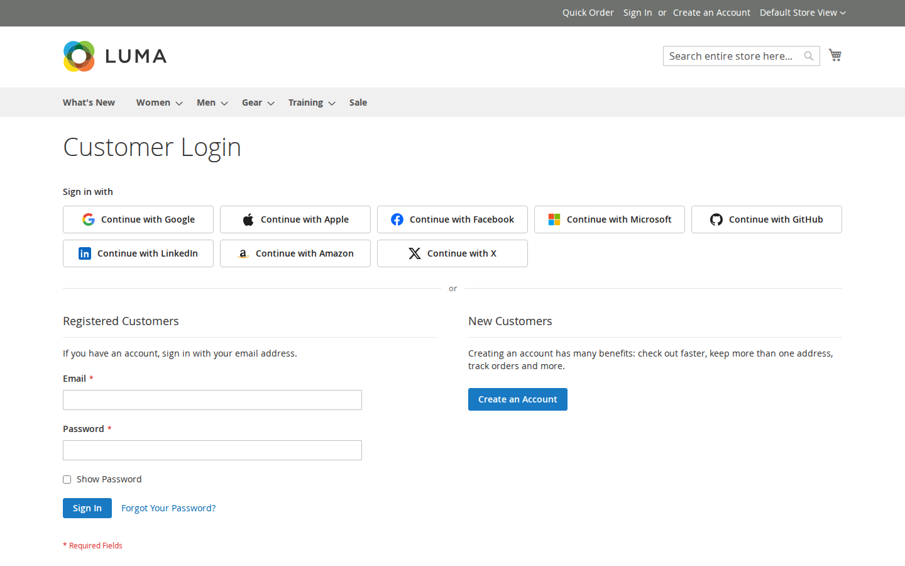

# Softaware Social Login Pro for Magento 2

Add-on for Softaware Social Login (`softaware/module-social-login`) that lets customers sign in and register
with **Apple, Microsoft, LinkedIn, Amazon and GitHub**, next to Google, Facebook and X from Social Login. Like
Social Login, it implements OAuth 2.0 and OpenID Connect directly on Magento's HTTP client and PHP's OpenSSL
extension; no provider SDKs or JWT libraries are installed. Works with Luma-based themes and Hyvä.

Package `softaware/module-social-login-pro`, module `Softaware_SocialLoginPro`.

- [User guide](docs/user-guide.md) (installation, provider setup, compatibility) · [FAQ](docs/faq.md) ·
  [Changelog](CHANGELOG.md)

## Features

- **Sign in with Apple**: client secret created for each request as an ES256 JWT from your .p8 key (valid for five
  minutes), `response_mode=form_post` callback with the shopper's session restored, ID token validated against
  Apple's JWKS. The name Apple sends on the first authorisation is used for the new account.
- **Microsoft (Entra ID, v2.0 endpoint)**: work, school and personal accounts (`common` tenant by default, or
  `consumers`, `organizations` or your tenant ID), PKCE, ID token validated against the tenant's JWKS; the issuer
  must match the token's tenant, and a configured tenant ID, `consumers` or `organizations` is enforced.
- **LinkedIn** ("Sign In with LinkedIn using OpenID Connect"): ID token validated against LinkedIn's JWKS.
- **Amazon** (Login with Amazon): authorisation code flow with PKCE.
- **GitHub** (OAuth App): PKCE; the email address comes from `/user/emails`, so only verified addresses are used.
- **Email trust**: Apple, LinkedIn (`email_verified`), GitHub (verified flag) and Microsoft (personal accounts, or
  `xms_edov` for work and school accounts) addresses count as verified and can link to an existing account with the
  same email automatically (if Social Login's Accounts settings allow it). Amazon gives no verification flag, so its
  addresses are treated as unverified: new accounts get Magento's confirmation email and existing customers enter
  their password once.
- Everything else comes from Social Login and works for these providers too: popup or redirect, all button places,
  widget and layout block, button style and colour, account matching, Create New Accounts, Connected Accounts,
  Linked Accounts grid, customer tab, CLI, Customer Approval integration, GDPR clean-up, Luma and Hyvä.
- **Self-test**: `bin/magento softaware:social-login:self-test` additionally checks the five providers'
  authorisation requests (endpoint, state, PKCE, nonce, form_post) and the Apple client secret (ES256 signature,
  key pasted without line breaks, invalid and non-P-256 keys rejected). No calls to the providers.

## Configuration

The providers are added as groups to Social Login's section: Stores > Configuration > Softaware > Social Login
(`softaware_sociallogin/<code>/...`). Access is controlled by Social Login's "Configuration" ACL resource.

| Group | Settings |
| --- | --- |
| Apple | Enabled (with the callback URL), Services ID, Team ID, Key ID, private key (.p8, stored encrypted), button label, sort order |
| Microsoft | Enabled, application (client) ID, client secret (encrypted), tenant, button label, sort order |
| GitHub, LinkedIn, Amazon | Enabled, client ID, client secret (encrypted), button label, sort order |

Provider codes (config group and callback URL segment): `apple`, `microsoft`, `github`, `linkedin`, `amazon`.
Default button order (sort order): Google 10, Apple 20, Facebook 30, Microsoft 40, GitHub 50, LinkedIn 60,
Amazon 70, X 80.

Scope: default, website and store view. Social Login's **General > Enabled** switch applies to these providers too.

## Provider setup in short

Register the callback URL shown under each provider's **Enabled** field exactly as displayed (one per store view URL):

- **Apple**: Services ID with "Sign in with Apple" (domain + return URL), a key with "Sign in with Apple";
  enter Services ID, Team ID, Key ID and paste the .p8 file.
- **Microsoft**: App registration for "any organisational directory and personal Microsoft accounts", Web
  redirect URI, client secret.
- **GitHub**: OAuth App, "Authorization callback URL".
- **LinkedIn**: product "Sign In with LinkedIn using OpenID Connect", authorised redirect URL.
- **Amazon**: Login with Amazon security profile, "Allowed Return URLs".

## Compatibility

- Requires `softaware/module-social-login` ^1.3 and `softaware/module-core` ^1.0.
- Magento Open Source / Adobe Commerce 2.4.7 – 2.4.9, PHP 8.2 – 8.5, ext-openssl.
- Luma, Blank and themes based on them; Hyvä 1.3+ (tested with Hyvä 1.5). The module has no templates of its own;
  the buttons are rendered by Social Login's Luma and Hyvä templates.

## Limitations

- Real provider sign-ins could not be tested on the development server (no provider apps); the authorisation
  requests and the Apple client secret are covered by the self-test, the shared flow by Social Login's test provider.
- Apple sends the customer's name only on the first authorisation and may hide the email address; the customer then
  completes a short form once.
- Microsoft: given and family name are only returned when configured as optional claims; otherwise the display
  name is split.
- Amazon addresses are treated as unverified (see Email trust).

## Uninstalling

`composer remove softaware/module-social-login-pro`, then `bin/magento setup:upgrade`. Settings and existing links
are kept; Social Login shows links of these providers with their provider code, and they can be removed in the
admin or by the customer.
