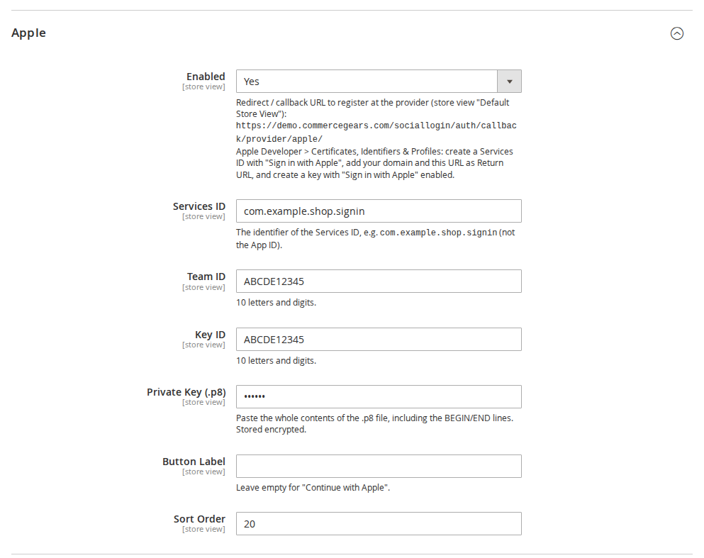
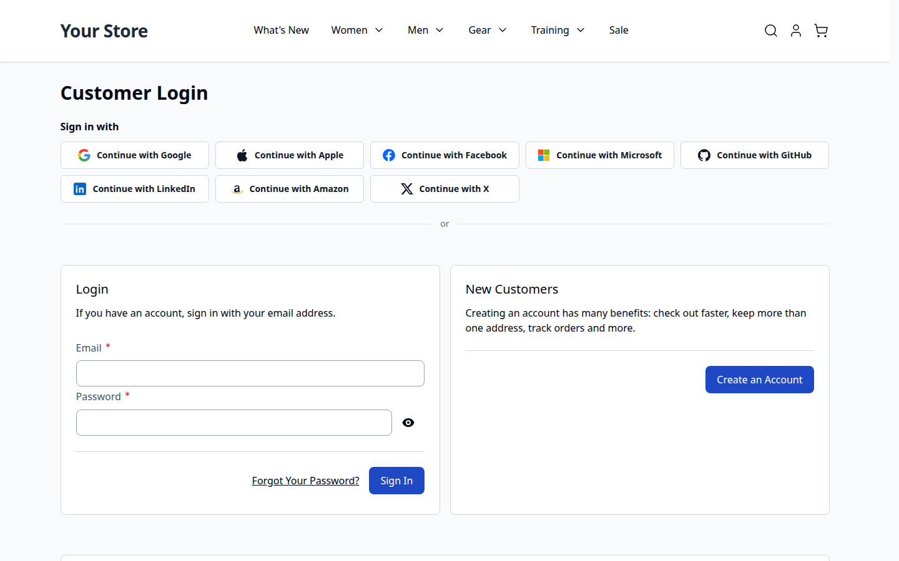
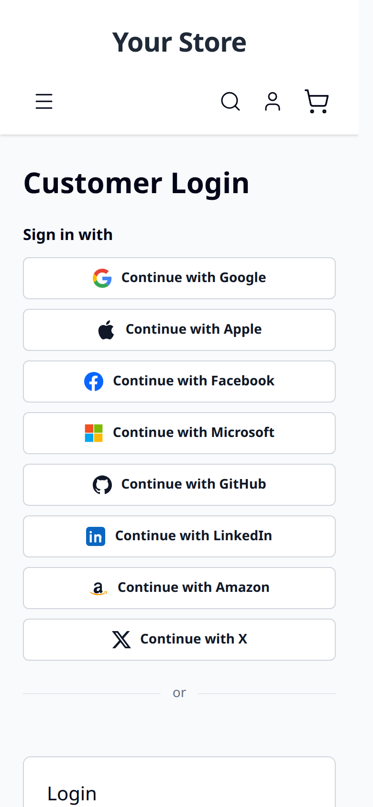

# Social Login Pro for Magento 2: User Guide

Social Login Pro adds **Apple, Microsoft, LinkedIn, Amazon and GitHub** to CommerceGears Social Login, next to Google,
Facebook and X. This guide covers installation, the setup of each provider and compatibility. For everything else
(where the buttons appear, popup or redirect, accounts, Connected Accounts, admin tools, CLI, privacy and
troubleshooting) see the Social Login user guide; it applies to these providers too.

- Product page: https://commercegears.com/magento-2-extensions/social-login-pro-for-magento-2/
- Social Login (free, required): https://commercegears.com/magento-2-extensions/social-login-for-magento-2/
- Changelog: [CHANGELOG.md](../CHANGELOG.md) · Questions: [FAQ](faq.md)


## 1. Requirements

| | |
| --- | --- |
| Magento | Open Source or Adobe Commerce 2.4.7 to 2.4.9 |
| PHP | 8.2 to 8.5 with `ext-openssl` and `ext-json` |
| Themes | Luma, Blank and themes based on them; Hyvä 1.3+ |
| Other | `commercegears/module-social-login` 1.3 or later and `commercegears/module-core` (installed automatically) |

## 2. Installation

With Composer, using the Composer keys from your account on commercegears.com (My account > Composer keys,
https://commercegears.com/my-modules/keys/). If the CommerceGears repository is already configured for Social Login, only the `composer require`
line is needed:

```bash
composer config repositories.commercegears composer https://repo.commercegears.com
composer config --auth http-basic.repo.commercegears.com PUBLIC_KEY PRIVATE_KEY
composer require commercegears/module-social-login-pro
bin/magento setup:upgrade
bin/magento setup:di:compile            # production mode only
bin/magento setup:static-content:deploy # production mode only
bin/magento cache:flush
```

The module has no templates or styles of its own, so no Hyvä Tailwind build is needed for it.

To update later: `composer update commercegears/module-social-login-pro`, then the same `bin/magento` commands.

## 3. Where the settings are

**Stores > Configuration > CommerceGears > Social Login** (also under **CommerceGears > Social Login > Configuration**).
Social Login Pro adds the groups **Apple**, **Microsoft**, **GitHub**, **LinkedIn** and **Amazon** between Social
Login's provider groups. Social Login's **General > Enabled** must be **Yes**.

Each provider has **Enabled**, its credentials (secrets are stored encrypted), an optional **Button Label** (empty =
"Continue with …") and a **Sort Order** for the button position. All settings can be set per website and store view.

When you set **Enabled = Yes**, the **callback URL** for the current store view is shown below the field, for
example `https://www.example.com/sociallogin/auth/callback/provider/apple/`. Register it at the provider **exactly
as shown**; with several store views or domains, register one per store view URL.



## 4. Setting up the providers

### Apple

1. Apple Developer > Certificates, Identifiers & Profiles: create a **Services ID** and enable **Sign in with
   Apple** for it. Add your domain and the callback URL as **Return URL**.
2. Under **Keys**, create a key with **Sign in with Apple** enabled and download the .p8 file.
3. In Magento enter the **Services ID** (the identifier, e.g. `com.example.shop.signin`, not the App ID), your
   **Team ID**, the **Key ID**, and paste the whole contents of the .p8 file (including the BEGIN/END lines) into
   **Private Key (.p8)**.

Apple posts its answer back to the store (`form_post`); the module restores the shopper's session, so the cart is
kept. Apple sends the customer's name only on the first authorisation and lets customers hide their email address.
If name or email is missing, the customer completes a short form once.

### Microsoft

1. Microsoft Entra admin centre > **Entra ID** > **App registrations** > New registration: under "Supported account
   types" choose "Any Entra ID Tenant + Personal Microsoft accounts" (or narrower, matching the **Tenant** you set
   below).
2. Under **Authentication** add the callback URL as a **Web** redirect URI, and under **Certificates & secrets**
   create a **client secret**.
3. In Magento enter the **Application (client) ID** and **Client Secret**. **Tenant**: `common` (work, school and
   personal accounts, default), `consumers` (personal only), `organizations` (work and school only) or your tenant
   ID (only your organisation).

Given and family name are only returned when you add them as optional claims in the app registration; otherwise the
display name is split.

### GitHub

1. GitHub > Settings > Developer settings > **OAuth Apps** > New OAuth App; enter the callback URL as
   **Authorization callback URL**.
2. In Magento enter **Client ID** and **Client Secret**.

The email address is read from the customer's verified GitHub addresses (the primary one if verified).

### LinkedIn

1. LinkedIn Developers: create an app and add the product **Sign In with LinkedIn using OpenID Connect**.
2. Under **Auth**, add the callback URL to **Authorized redirect URLs**.
3. In Magento enter **Client ID** and **Client Secret**.

### Amazon

1. Amazon Developer Console > **Login with Amazon**: create a security profile.
2. Under **Web Settings**, add the callback URL to **Allowed Return URLs**.
3. In Magento enter **Client ID** and **Client Secret**.

Amazon does not say whether an address is verified, so new accounts get Magento's confirmation email and existing
customers enter their password once to connect Amazon.

## 5. Button order

The default sort orders keep this order: Google (10), Apple (20), Facebook (30), Microsoft (40), GitHub (50),
LinkedIn (60), Amazon (70), X (80). Change **Sort Order** to rearrange.

| Hyvä | Mobile |
| --- | --- |
|  |  |

## 6. Checking the installation

```bash
bin/magento commercegears:social-login:self-test
```

The output starts with the registered providers (it should list `apple, microsoft, github, linkedin, amazon`) and
includes the sections "Social Login Pro providers" and "Sign in with Apple client secret". No provider is contacted.

## 7. Compatibility

- CommerceGears Social Login 1.3 or later (required), CommerceGears Customer Approval (optional, via Social Login).
- Magento Open Source / Adobe Commerce 2.4.7 to 2.4.9, PHP 8.2 to 8.5.
- Luma, Blank and Luma-based themes; Hyvä 1.3+ (tested with 1.5). The Hyvä checkout uses the Luma checkout
  fallback, so the checkout buttons are the Luma ones.

## 8. Uninstall

```bash
bin/magento module:disable CommerceGears_SocialLoginPro
composer remove commercegears/module-social-login-pro
bin/magento setup:upgrade
```

Customers keep their accounts. Links to these providers stay stored and are shown with their provider code in
Social Login's admin tools and under Connected Accounts, where they can be removed. The settings stay in the
database.
